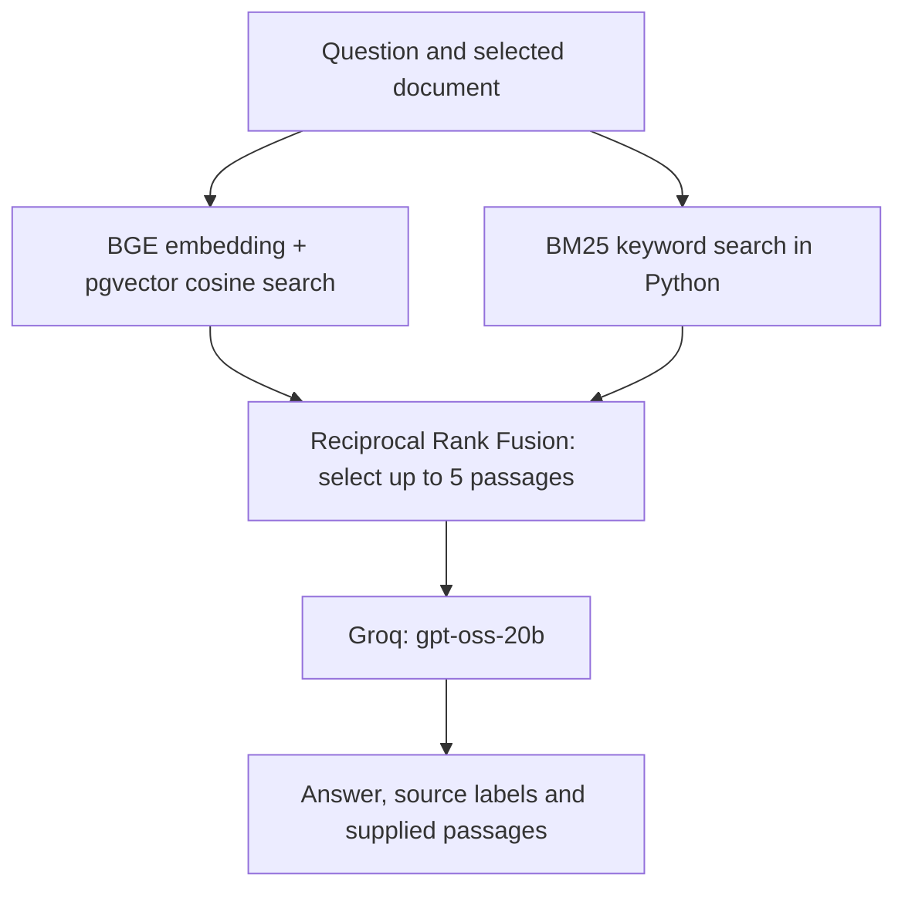

# Enterprise Document Intelligence

Search business documents, ask questions in plain English, and inspect the passages used to generate an answer.

**[Open the live demo](https://enterprise-document-intelligence-hpuelukdub93lz7xdquyc3.streamlit.app/)** · [View the code](https://github.com/toBESkiii/enterprise-document-intelligence)

A Python document Q&A application built around **10 Unilever reports and policies, 874 PDF pages, and 2,994 text passages**. It combines meaning-based search with keyword search, then supplies selected passages to an answering model. The interface displays source filenames, PDF page numbers and the actual evidence sent to the model.

**Status:** hosted portfolio prototype, not a production compliance tool. The collection contains saved document editions; it is not a live feed of current Unilever policies. This is an independent project, not affiliated with or endorsed by Unilever.

## Try it

1. Open the demo and select a document from **Explore documents**, or choose **Whole collection**.
2. Select a suggested question or type your own, then click **Ask question**.
3. Expand the source passages below the answer. Check the evidence, including dates, conditions and exceptions.

Example questions:

- **Audit Requirements:** Which audit standard applies to partners handling or supplying raw materials and finished goods?
- **Annual Report 2025:** How much did Unilever spend on Research and Development in 2025?
- **Unsupported-information check:** According to the Audit Requirements, what fixed price in pounds must every partner pay for a SMETA audit?

The last question is intended to test whether the system declines to invent information. A refusal means the retrieved passages were insufficient; it does not prove that an answer is absent from every document.

## What the application does

- Searches one selected document or the whole collection.
- Combines BGE embeddings, PostgreSQL/pgvector cosine search and BM25 keyword search.
- Generates answers with source labels such as `[S1]`, and displays the supplied passages for inspection.
- Provides document-specific suggested questions and prepared, source-referenced overviews.
- Shows retrieval and answer-generation timings, excluding initial model setup.
- Warns about missing or unknown citation labels and incomplete outputs.

**The overviews are prepared text, not summaries generated live from an entire PDF.** The demo does not accept uploads or offer an interactive PDF viewer.

## How it works

This is a retrieval-augmented generation (RAG) system: it finds evidence first, then asks a language model to answer using that evidence.



The document selection constrains both searches. BM25 statistics are built over the full collection, while candidates are filtered to the selected scope. Passages shorter than 20 words are excluded from search, but retained in storage.

Reciprocal Rank Fusion (RRF) combines up to 50 results from each search method, using a rank constant of 60. Up to five passages are selected. The answer request drops whole lower-ranked passages if needed to fit its size guard; the interface shows only the sources actually supplied.

Only the question is embedded at request time. Passage vectors were generated beforehand and stored in Neon. The models are pretrained; this project does not train or fine-tune them. Retrieval scores rank passages; they are not answer-confidence percentages.

## Document preparation

The development pipeline extracted page-level text with `pypdf`, cleaned it, created overlapping chunks and checked their lengths using the BGE tokenizer. Filenames, physical PDF page numbers and chunk IDs were retained throughout.

| Collection measure | Result |
|---|---:|
| Documents | 10 |
| PDF pages processed | 874 |
| Pages containing extracted text | 870 |
| Raw extracted characters | 3,242,704 |
| Final token-safe passages | 2,994 |
| Longest passage in the token check | 480 tokens |
| Embedding dimensions | 384 |

The initial 2,985-chunk collection contained nine passages exceeding the model's 512-token limit. Token-safe splitting produced 2,994 passages, with none over the limit. A separate coverage check found no gaps in coverage of the **cleaned extracted page text**. This does not establish that every table, chart or visual detail was extracted correctly.

The saved text, metadata and vectors were imported into local PostgreSQL and then Neon. Import verification checked that stored records matched the saved collection without regenerating embeddings.

<details>
<summary>Documents in the collection</summary>

| ID | Saved document | PDF pages |
|---|---|---:|
| UL01 | Annual Report 2025 | 285 |
| UL02 | Annual Report 2024 | 305 |
| UL03 | Climate Transition Action Plan 2024 | 53 |
| UL04 | Modern Slavery Statement 2026 | 17 |
| UL05 | Modern Slavery Statement 2025 | 16 |
| UL06 | Responsible Partner Policy | 37 |
| UL07 | Responsible Partner Implementation Guidance | 112 |
| UL08 | Audit Requirements | 5 |
| UL09 | People and Nature Policy | 10 |
| UL10 | Code of Business Principles | 34 |

Page references are physical PDF positions, starting at 1, and may differ from printed page numbers. Publication years and reporting periods can also differ.

</details>

## Technology

| Component | Implementation |
|---|---|
| Interface and hosting | Streamlit, Streamlit Community Cloud |
| Embeddings | `BAAI/bge-small-en-v1.5`, Sentence Transformers, CPU inference |
| Retrieval | PostgreSQL/pgvector cosine search, Python `rank-bm25`, RRF |
| Hosted database | Neon PostgreSQL with a restricted reader account |
| Live answering model | `openai/gpt-oss-20b` through Groq |
| Earlier local implementation | Qwen3 4B through Ollama; PostgreSQL/pgvector in Docker Compose |
| Development | Python 3.11, Git/GitHub, `pypdf` for extraction |

The live demo does not require Ollama or a PostgreSQL container on the visitor's computer.

## Evaluation and findings

### Retrieval development checks

On ten development questions, with a document filter and the 20-word cutoff, the reviewed complete-evidence coverage within the top five results was:

| Method | Questions with a complete accepted evidence set in the top five |
|---|---:|
| Vector search | 7/10 |
| BM25 keyword search | 7/10 |
| Hybrid search with RRF | 9/10 |

The answer key was reviewed to recognise alternative valid passages and evidence spread across multiple passages. These figures **rescore the same saved rankings**; they do not mean retrieval improved simply because the key changed. The questions were used during development, so this is not a held-out accuracy estimate.

Document filtering helped some questions. Removing document names from queries improved some rankings but worsened others. Cross-document comparison experiments remained unreliable, so comparison optimisation was paused for this first release.

### Earlier end-to-end tests: local Qwen backend

Each batch contained eight corpus-answerable questions and two deliberately unsupported questions.

| Check | Batch 1 | Batch 2 |
|---|---:|---:|
| Answerable questions with known evidence retrieved in the top five | 8/8 | 5/8 |
| Answerable questions with known evidence supplied to Qwen | 8/8 | 5/8 |
| Exact refusals on unsupported questions | 2/2 | 2/2 |
| Refusals on corpus-answerable questions | 0/8 | 2/8 |

Batch 1 checked a known evidence passage; Batch 2 checked complete known evidence groups and included harder comparison questions. The two retrieval measures are not identical. Missing a known passage may also leave a valid alternative.

**These are not answer-correctness or citation-support scores.** Those fields remained pending human review in the saved batch reports. These runs used the earlier Qwen backend, not the current Groq answering model.

### Current demo checks

Neon/Groq integration checks produced an audit-standard answer with a source label and declined an unsupported fixed-price question. The hosted interface also returned the expected refusal, and visitor access was checked without a sign-in prompt.

A known failure remains: an audit-standard answer omitted the source's risk-assessment condition, even after the prompt was strengthened. These checks demonstrate integration, not a general accuracy guarantee. A fresh, independently reviewed evaluation of the Groq-backed application remains future work.

## Run the application locally

### Prerequisites and data availability

The public demo is the easiest way to try the project. **Cloning this repository does not recreate its database.**

The repository currently publishes the application, database schema, local import utility and deployment configuration. The raw PDFs, processed passage/vector files, model weights, ingestion experiments and evaluation reports are not bundled in this release. The development results above describe work performed locally.

To run your own instance, first provision an authorised copy of the corpus in Neon, with pgvector enabled and the `edi.documents` and `edi.chunks` tables populated. See [the schema](create_document_tables.sql); creating tables alone does not import data. The current reader configuration expects database `neandb`, role `edi_reader`, and the fixed ten-document collection. The reader check expects 2,994 chunks. This is not yet a general-purpose ingestion package.

Use your own Groq key and database credentials. The demo's credentials are not distributed. Grant the application reader `SELECT` access to the two tables, not ownership, write access or elevated role membership.

### Windows / PowerShell

With Python 3.11 installed, create a fresh checkout and environment:

```powershell
git clone https://github.com/toBESkiii/enterprise-document-intelligence.git
cd enterprise-document-intelligence
py -3.11 -m venv .venv
.\.venv\Scripts\python.exe -m pip install -r requirements.txt
```

The root requirements file records the working Windows dependency versions; it is not a complete dependency lockfile. Do not install `cloud/requirements.txt` on Windows: it contains a Linux-specific CPU PyTorch wheel.

Create an untracked `.env.app` in the project root. Replace both placeholders privately:

```dotenv
NEON_READONLY_DATABASE_URL="YOUR_POSTGRESQL_READER_URL"
GROQ_API_KEY="YOUR_GROQ_API_KEY"
```

The reader URL must include its password and `sslmode=require` or stronger. Use a PostgreSQL URL, not a `psql` command. Environment variables take precedence over `.env.app`.

Check database permissions and counts, then start the app:

```powershell
.\.venv\Scripts\python.exe neon_database.py
.\.venv\Scripts\python.exe -m streamlit run cloud/app.py
```

The launcher enables BGE downloads on a fresh machine. The model and search engine load when a question is first submitted; prepared overviews do not need an answering-model request. Restart the application after changing the stored collection because passage text and BM25 statistics are cached.

## Deployment

The current deployment uses Streamlit Community Cloud, Neon and Groq. For an independently provisioned instance:

- Entrypoint: `cloud/app.py`.
- Python: **3.11**; the pinned CPU PyTorch wheel targets CPython 3.11 on Linux x86_64.
- Dependencies: `cloud/requirements.txt`, beside the entrypoint.
- Credentials: put `NEON_READONLY_DATABASE_URL` and `GROQ_API_KEY` in Streamlit's private Secrets settings as top-level quoted values, never in GitHub.

See the official [deployment guide](https://docs.streamlit.io/deploy/streamlit-community-cloud/deploy-your-app/deploy), [dependency rules](https://docs.streamlit.io/deploy/streamlit-community-cloud/deploy-your-app/app-dependencies) and [secrets guide](https://docs.streamlit.io/deploy/streamlit-community-cloud/deploy-your-app/secrets-management).

## Main files

| File | Purpose |
|---|---|
| [app_interface.py](app_interface.py) | Document navigation, prepared overviews, questions, answers and sources |
| [document_qa_groq.py](document_qa_groq.py) | Hosted answer requests, request-size guard and citation-label checks |
| [document_qa_postgres.py](document_qa_postgres.py) | Database-backed vector search, BM25 and RRF |
| [neon_database.py](neon_database.py) | Reader connection and permission/count checks |
| [document_qa.py](document_qa.py) | Shared retrieval/prompt utilities and the earlier file-based local implementation |
| [cloud/app.py](cloud/app.py) and [cloud/requirements.txt](cloud/requirements.txt) | Hosted launcher and Linux dependencies |
| [compose.db.yaml](compose.db.yaml) | Earlier local PostgreSQL/pgvector development service |
| [create_document_tables.sql](create_document_tables.sql) and [import_collection_to_postgres.py](import_collection_to_postgres.py) | Schema and local import/verification of previously saved passages and vectors |

## Privacy, safeguards and limitations

- **External processing:** the question, selected-document name and supplied source passages are sent to Groq. Do not enter personal or confidential information.
- **Restricted database access:** the deployed reader was checked for read access without write privileges or ownership of the application tables. Runtime connections use read-only transactions and parameterised SQL.
- **Secrets stay outside Git:** `.env` files and Streamlit secrets files are excluded. No database password or API key should be placed in the interface or repository.
- **Citations are not proof:** recognising `[S1]` does not establish that its passage supports every claim. Inspect the text yourself.
- **Retrieval can miss evidence:** the top five may not contain everything needed, especially for cross-report comparisons. The length cutoff can also exclude useful short facts.
- **Extraction is text-only:** OCR was not performed. Chart structure, tables, reading order and some spacing are imperfect; coverage checks apply to extracted text, not the entire visual PDF.
- **Scope can be lost:** models can omit conditions or confuse reporting years, targets and achieved results. Saved editions may no longer be current.
- **Limited service capacity:** first requests may be slower, provider limits may prevent answers, and the application is not load-tested for large-scale concurrent use. The Groq request has no automatic retry or paid fallback.

Future work includes publishing a reproducible ingestion/evaluation package, reviewing a fresh Groq test set, improving comparison retrieval and table extraction, and adding stronger public-demo usage controls. These are not completed features.

## Author and source documents

Built by **Olatunji Oluwatobi Samuel (Tobi)** as an applied-AI portfolio project covering document processing, NLP retrieval, RAG evaluation, PostgreSQL, Docker-based local development and hosted application delivery.

The underlying reports and policies are published by Unilever; their contents remain subject to the publisher's rights. This repository does not grant a licence to those documents. Consult the original source documents before making business or compliance decisions.
